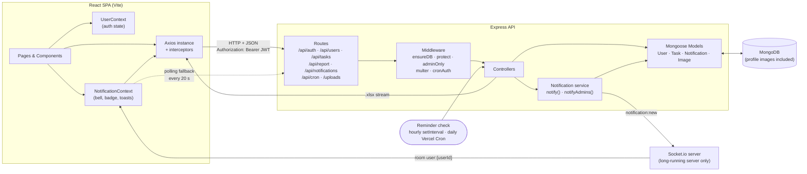
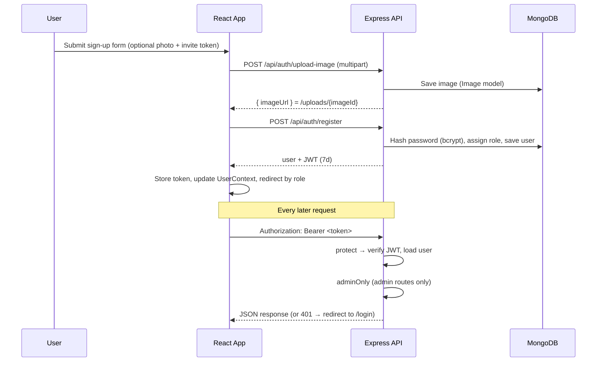
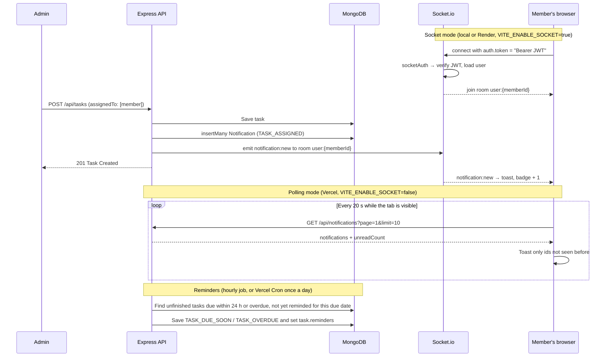
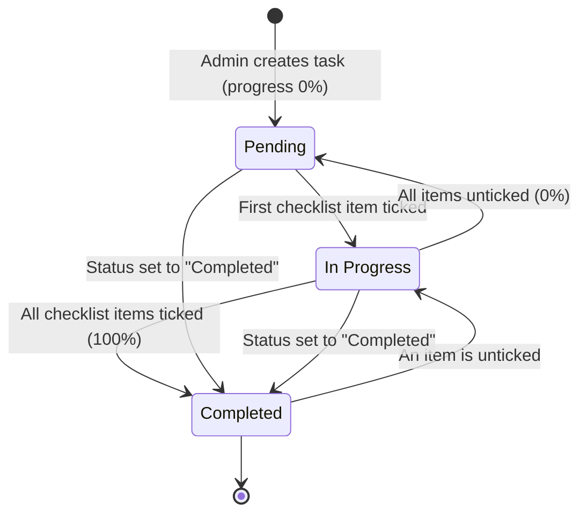

<div align="center">

# 📋 Task Manager

**A full-stack, role-based team task management platform built on the MERN stack.**

Admins create, assign and track work across a team. Members work through their tasks with interactive checklists, and progress and status update automatically as they go. Both roles get live analytics dashboards, in-app notifications and due-date reminders, and admins can export Excel reports.


</div>

---

## Table of Contents

- [Overview](#overview)
- [Key Features](#key-features)
- [Tech Stack](#tech-stack)
- [Architecture](#architecture)
- [How It Works](#how-it-works)
- [Project Structure](#project-structure)
- [Getting Started](#getting-started)
- [Environment Variables](#environment-variables)
- [Deployment on Vercel](#deployment-on-vercel)
- [API Reference](#api-reference)
- [Data Models](#data-models)
- [Available Scripts](#available-scripts)
- [Roadmap](#roadmap)
- [Author](#author)
- [License](#license)

---

## Overview

**Task Manager** is a full-stack web application for small teams that need a clear way to hand out work and see how it is going. It has two separate experiences:

| Role | What they can do |
| --- | --- |
| **Admin** | Create, edit and delete tasks. Assign tasks to one or more members. Break work into checklists. Attach reference links. Monitor the whole team from an analytics dashboard. Download Excel reports. Get notified when members join, update a checklist or complete a task, and when a task they created is overdue. |
| **Member** | See only the tasks assigned to them. Filter by status. Tick off checklist items. Follow progress on a personal dashboard. Get notified when a task is assigned to them, removed from them, changed by someone else, deleted, due soon or overdue. |

The project covers the full cycle of a production-style app: a REST API with layered routes, controllers, middleware and models; stateless JWT authentication; role-based authorization; image uploads stored in MongoDB; real-time notifications over Socket.io with a polling fallback; scheduled reminders; MongoDB aggregation pipelines for analytics; server-side spreadsheet generation; a responsive React SPA with global auth state, reusable components and data visualisation; and free serverless deployment on Vercel.

<!--
## Screenshots

> Add screenshots to `docs/screenshots/` and uncomment this section.

| Admin Dashboard | Manage Tasks |
| --- | --- |
|  |  |

| Create / Edit Task | Task Details (Member) |
| --- | --- |
|  |  |

| Team Members | Sign Up |
| --- | --- |
|  |  |
-->

---

## Key Features

### 🔐 Authentication & Access Control
- **JWT authentication** with 7-day tokens, passwords hashed with **bcrypt**.
- **Two roles, `admin` and `member`.** Admin sign-up needs a secret **Admin Invite Token**, so ordinary users cannot promote themselves.
- **Server-side authorization** through Express middleware (`protect`, `adminOnly`). Checklist and status updates also check that the caller is **assigned to that task**.
- **Optional profile photo on sign-up** with a live preview. Photos are uploaded through **Multer** (JPG, JPEG or PNG, up to 2 MB, file content checked too) and **stored in MongoDB**, so they survive redeploys on serverless hosting.
- **Persistent sessions:** the token lives in `localStorage` and the user profile is fetched again on page load. An Axios interceptor attaches the `Bearer` token to every request and sends the user to the login page when the API returns `401`.
- **Role-aware landing:** `/` redirects to the admin or member dashboard depending on the logged-in user.
- **Client-side route guards:** `PrivateRoute` sends logged-out users to `/login` and only renders admin pages for admins and member pages for members.
- **Profile update API:** `PUT /api/auth/profile` changes the current user's name and email (there is no profile page in the UI yet).

### 🛠️ Admin Workspace
- **Analytics dashboard**
  - Summary counters: total, pending, in-progress and completed tasks.
  - **Donut chart** of tasks by status.
  - **Bar chart** of tasks by priority (Low / Medium / High).
  - **Recent tasks** table showing the 10 newest tasks.
- **Create and edit tasks** in one form with:
  - title, description, priority dropdown and due date (dates in the past are rejected);
  - a **multi-member picker** in a modal, shown as a stacked avatar group;
  - a **checklist builder** to add and remove to-do items;
  - **attachment links** for specs, designs, docs and similar.
  - Client-side validation covers every required field.
  - When a task is edited, checklist items that already exist **keep their completion state**.
- **Manage tasks:** a card grid with status tabs that show live counts. Each card shows status and priority badges, a colour-coded progress bar, `done / total` checklist items, start and due dates, assignee avatars and the number of attachments. Clicking a card opens it for editing, and deleting asks for confirmation in a modal.
- **Team members:** a card for every member with counts of their pending, in-progress and completed tasks.
- **Excel reports (.xlsx)**, generated on the server with **ExcelJS** and downloaded from the browser:
  - **Tasks report:** ID, title, description, priority, status, due date and assignees.
  - **Users report:** each user's total, pending, in-progress and completed tasks.

### 👤 Member Workspace
- **Personal dashboard** with the same counters and charts, limited to the member's own tasks.
- **My Tasks:** only the tasks assigned to the member, with status tabs.
- **Task details page** with:
  - an **interactive checklist** that updates the screen immediately and **rolls back** if the API call fails;
  - clickable attachment links that open in a new tab, with `https://` added when it is missing;
  - assignee avatars, priority, due date and a colour-coded status badge.

### ⚙️ Automatic Progress Tracking
- Task **progress (%)** is calculated on the server from the checklist whenever it changes.
- **Task status follows progress:** `0%` is **Pending**, `1–99%` is **In Progress**, `100%` is **Completed**.
- Setting a task to **Completed** through the status endpoint marks every checklist item as done and sets progress to 100%.

### 🔔 Notifications & Reminders
- **Notification bell** in the navbar with an **unread badge** (shows `99+` above 99).
- The panel lists notifications newest first, highlights unread ones and shows relative times ("5 minutes ago"). Actions: **Mark all read**, **Clear**, delete one (trash icon) and **Load More** (10 per page).
- **Click to open the task:** clicking a notification marks it as read. Admins go to the task's edit form; members go to the task details page if they are still assigned to it.
- **Live delivery with Socket.io:** the server pushes `notification:new` to the user's private room and a toast pops up straight away.
- **Polling fallback** for hosts without WebSockets (Vercel): the app calls `GET /api/notifications` every 20 seconds, pauses while the browser tab is hidden, catches up as soon as it is visible again, and only toasts notifications it has not seen yet.
- **Scheduled reminders** for tasks that are not completed: **due soon** (less than 24 hours left) and **overdue**. Each one is sent **once per due date** (tracked in `task.reminders`), so moving the due date arms it again.
- Notifications are **deleted automatically after 90 days** (MongoDB TTL index).

### 🎨 UI / UX
- Responsive layout. Below 1080px the sidebar is hidden and opened from a hamburger menu.
- Toast notifications through `react-hot-toast`.
- Design tokens (primary colour, Poppins font, custom breakpoint) defined with Tailwind CSS v4 `@theme`, plus reusable component classes.
- Reusable building blocks: `Modal`, `DeleteAlert`, `AvatarGroup`, `Progress`, `TaskCard`, `UserCard`, `InfoCard`, `TaskStatusTabs`, `SelectDropdown`, `SelectUsers`, `TodoListInput`, `AddAttachmentsInput`, custom chart tooltips and legends.

---

## Tech Stack

### Frontend
| Technology | Purpose |
| --- | --- |
| **React 19** | Component-based UI |
| **Vite 7** | Dev server and production bundler |
| **React Router 7** | Client-side routing with nested layout routes |
| **Tailwind CSS 4** | Utility-first styling via `@tailwindcss/vite` |
| **Context API** | Global auth/user state (`UserContext`) and notifications (`NotificationContext`) |
| **Axios** | HTTP client with request/response interceptors |
| **Socket.io Client 4** | Live notifications (when `VITE_ENABLE_SOCKET` is `true`) |
| **Recharts 3** | Donut and bar charts |
| **Moment.js** | Date formatting, validation and relative times |
| **React Icons** | Icon set (Lucide, Heroicons, Font Awesome) |
| **React Hot Toast** | Toast pop-ups |
| **ESLint 9** | Linting (flat config with React Hooks and React Refresh rules) |

### Backend
| Technology | Purpose |
| --- | --- |
| **Node.js + Express 5** | REST API server |
| **MongoDB + Mongoose 8** | Database and ODM, including aggregation pipelines for analytics |
| **JSON Web Token** | Stateless authentication |
| **bcryptjs** | Password hashing |
| **Multer** | Multipart uploads for profile images, kept in memory (2 MB max) and then saved in MongoDB |
| **Socket.io 4** | Real-time notifications (JWT handshake, one room per user) |
| **ExcelJS** | Generates `.xlsx` reports that stream to the client |
| **cors / dotenv** | CORS settings and environment config |
| **Nodemon** | Reloads the server during development |

### Hosting
| Technology | Purpose |
| --- | --- |
| **Vercel** (Hobby, free) | Frontend as a static site, backend as one serverless function, daily **Vercel Cron** for reminders |
| **MongoDB Atlas** (free M0) | Database for users, tasks, notifications and images |
| **Render** (free, optional) | Fallback host for the backend as a long-running server, so Socket.io works |

---

## Architecture



### Authentication Flow



### Notification Flow



---

## How It Works

### Role-Based Access
- A new user becomes an **admin** only if the `adminInviteToken` sent at sign-up matches `ADMIN_INVITE_TOKEN` on the server. Everyone else becomes a **member**.
- `protect` checks the JWT and puts the user on `req.user`. `adminOnly` rejects anyone whose role is not `admin`.
- `GET /api/tasks` returns different data by role: admins get **every** task, members only get tasks where they are listed in `assignedTo`.

### Task Lifecycle



When a checklist is updated (`PUT /api/tasks/:id/todo`), the server works out:

```js
progress = Math.round((completedItems / totalItems) * 100);
status   = progress === 100 ? "Completed" : progress > 0 ? "In Progress" : "Pending";
```

### Dashboard Analytics
Dashboard endpoints use MongoDB **aggregation pipelines** (`$match` → `$group`) to count tasks by status and by priority. They return a single response containing statistics, chart data and recent tasks, which the React dashboard turns into Recharts datasets. The response also includes an **overdue** count: tasks that are not completed and whose due date has passed.

### Reports
Report endpoints build an Excel workbook in memory with ExcelJS and **stream it straight into the HTTP response**. The frontend requests it with `responseType: "blob"` and starts the download through a temporary object URL.

### Notifications
Controllers call event helpers in `services/notificationEvents.js`, which decide who should hear about a change. `notify()` then saves one `Notification` per recipient and, when a Socket.io server is running, emits `notification:new` to each recipient's room. **The person who made the change never gets their own notification.** The calls are awaited before the response is sent, because serverless platforms stop work once the response is out.

| Event | Type | Who receives it |
| --- | --- | --- |
| Admin creates a task | `TASK_ASSIGNED` | The assignees |
| Admin edits a task and adds members | `TASK_ASSIGNED` | The newly added members |
| Admin edits a task and removes members | `TASK_UNASSIGNED` | The removed members |
| Task deleted | `TASK_DELETED` | The task's creator and assignees |
| Status changed (status endpoint, or a checklist change that moves the status) | `TASK_STATUS_CHANGED` | The task's creator and assignees |
| Status changed to Completed | `TASK_COMPLETED` | The task's creator and assignees |
| Checklist progress changed but the status stayed the same | `TASK_CHECKLIST_UPDATED` | The task's creator and assignees |
| Less than 24 hours until the due date | `TASK_DUE_SOON` | The assignees |
| Due date passed and the task is not completed | `TASK_OVERDUE` | The task's creator and assignees |
| A new user signs up | `USER_REGISTERED` | Every admin |

**Delivery to the browser:**
- **Socket.io** (local and Render). The client connects with `auth: { token: "Bearer <JWT>" }`. The `socketAuth` middleware verifies the JWT and loads the user, then the socket joins the room `user:<userId>`. After a reconnect the client reloads the first page of notifications so nothing is missed.
- **Polling** (Vercel). Vercel functions cannot hold Socket.io connections open, so with `VITE_ENABLE_SOCKET=false` the client polls `GET /api/notifications?page=1&limit=10` every 20 seconds. It stops while `document.hidden` is true and polls once as soon as the tab is visible again. The ids it already has are kept in a ref, so only new notifications are added to the list and toasted.

**Scheduled reminders:** `checkDueDates()` in `controllers/taskRemindeers.js` looks for tasks that are not completed and are either due within 24 hours or already overdue. After a reminder is sent, the task's due date is copied into `task.reminders.dueSoonSentFor` or `task.reminders.overdueSentFor`, so each reminder goes out **once per due date** even if the check runs again. Where it runs:
- `npm run dev` / `npm start` (local or Render): once at startup, then **every hour** with `setInterval`.
- Vercel: **Vercel Cron** calls `GET /api/cron/reminders` **once a day** (`0 6 * * *`, UTC; on Hobby it can fire any time in that hour). The route checks `Authorization: Bearer <CRON_SECRET>` before it touches the database. With one run a day, a reminder can arrive up to a day later than with the hourly job.

### Image Storage
`POST /api/auth/upload-image` keeps the file in memory with Multer (2 MB max, JPG/JPEG/PNG, first bytes checked), saves it in the `Image` collection and returns `{ imageUrl }` pointing to `GET /uploads/:id`. That route serves the bytes with a one-year `Cache-Control` header, since an image never changes. Images saved on disk by older versions are still served from `backend/uploads/` when they exist locally. `app.set("trust proxy", 1)` makes the returned URLs `https` behind the Vercel or Render proxy.

---

## Project Structure

```
Task Manager/
├── backend/
│   ├── api/
│   │   └── index.js               # Vercel entry: exports the Express app
│   ├── config/
│   │   ├── db.js                  # Cached MongoDB connection (reused between requests)
│   │   └── cors.js                # CLIENT_URL → list of allowed origins
│   ├── controllers/
│   │   ├── authController.js      # Register, login, profile
│   │   ├── taskController.js      # Task CRUD, status, checklist, dashboards
│   │   ├── userController.js      # Members + per-user task statistics
│   │   ├── reportController.js    # Excel report generation
│   │   ├── notificationController.js  # List, mark read, read all, delete, clear
│   │   ├── imageController.js     # Save uploads in MongoDB, serve /uploads/:id
│   │   ├── socketController.js    # Socket.io rooms (user:<id>)
│   │   └── taskRemindeers.js      # Due-soon / overdue check (hourly job + cron handler)
│   ├── middlewares/
│   │   ├── authMiddleware.js      # protect (JWT) & adminOnly
│   │   ├── uploadMiddleware.js    # Multer memory storage, 2 MB, jpg/jpeg/png
│   │   ├── dbMiddleware.js        # ensureDB: waits for MongoDB, JSON 500 if it is down
│   │   ├── cronAuth.js            # Checks Authorization: Bearer <CRON_SECRET>
│   │   └── socketAuth.js          # JWT check for Socket.io connections
│   ├── models/
│   │   ├── User.js
│   │   ├── Task.js                # Task + embedded todo sub-schema + reminders
│   │   ├── Notification.js        # Per-user notifications (90-day TTL)
│   │   └── Image.js               # Uploaded profile images (Buffer)
│   ├── routes/
│   │   ├── authRoutes.js
│   │   ├── taskRoutes.js
│   │   ├── userRoutes.js
│   │   ├── reportRoutes.js
│   │   ├── notificationRoutes.js
│   │   ├── cronRoutes.js          # GET /api/cron/reminders
│   │   └── imageRoutes.js         # GET /uploads/:id
│   ├── services/
│   │   ├── notificationService.js # notify(): save + emit over Socket.io
│   │   └── notificationEvents.js  # Who gets notified for each event
│   ├── utils/
│   │   └── notificationTypes.js   # Notification type names
│   ├── public/                    # The only folder Vercel serves as static files
│   ├── uploads/                   # Old images saved on disk (git-ignored, local only)
│   ├── appSocket.js               # Socket.io server (initSocket / getIO)
│   ├── server.js                  # Express app; listen + Socket.io + hourly job only when run directly
│   ├── vercel.json                # Rewrite everything to /api, daily cron
│   ├── .env.example
│   └── package.json
│
└── frontend/Task-Manager/
    ├── public/
    ├── src/
    │   ├── assets/                # Images
    │   ├── components/
    │   │   ├── Cards/             # TaskCard, UserCard, InfoCard
    │   │   ├── Charts/            # CustomPieChart, CustomBarChart, tooltip, legend
    │   │   ├── inputs/            # Input, SelectDropdown, SelectUsers, TodoListInput,
    │   │   │                      # AddAttachmentsInput, ProfilePhotoSelector
    │   │   ├── layouts/           # AuthLayout, DashboardLayout, Navbar, SideMenu, AvatarGroup
    │   │   ├── notifications/     # NotificationBell (badge + panel)
    │   │   ├── Modal.jsx
    │   │   ├── DeleteAlert.jsx
    │   │   ├── Progress.jsx
    │   │   ├── TaskListTable.jsx
    │   │   └── TaskStatusTabs.jsx
    │   ├── context/
    │   │   ├── UserContext.jsx    # Auth state provider
    │   │   └── NotificationContext.jsx  # Notifications: Socket.io or 20 s polling
    │   ├── hooks/
    │   │   └── useUserAuth.jsx    # Redirects unauthenticated users
    │   ├── pages/
    │   │   ├── Auth/              # Login, SignUp
    │   │   ├── Admin/             # Dashboard, ManageTasks, CreateTask, ManageUsers
    │   │   └── User/              # UserDashboard, MyTasks, ViewTaskDetails
    │   ├── routes/
    │   │   └── PrivateRoute.jsx
    │   ├── utils/
    │   │   ├── apiPaths.js        # BASE_URL (from VITE_API_URL) + all endpoint paths
    │   │   ├── axiosinstance.js   # Axios instance + interceptors
    │   │   ├── uploadimage.js     # Image upload helper
    │   │   ├── data.js            # Menu config, status & priority options
    │   │   └── helper.js          # Validation / formatting helpers
    │   ├── App.jsx                # Route definitions
    │   ├── main.jsx
    │   └── index.css              # Tailwind theme + component classes
    ├── vercel.json                # Sends every route to index.html (React Router)
    ├── .env.example
    ├── vite.config.js
    └── package.json
```

---

<!-- ## Getting Started -->

<!-- ### Prerequisites -->
<!-- - **Node.js** 20.19+ (required by Vite 7) and **npm**
- A **MongoDB** database, either local or on [MongoDB Atlas](https://www.mongodb.com/atlas) -->

<!-- ### 1. Clone the repository -->
<!-- ```bash
git clone https://github.com/<your-username>/<repo-name>.git
cd <repo-name>
``` -->

<!-- ### 2. Set up the backend -->
<!-- ```bash
cd backend
npm install
``` -->

<!-- Create a `backend/.env` file (copy `backend/.env.example`): -->

<!-- ```env
MONGO_URI=mongodb+srv://<user>:<password>@<cluster>/<database>
JWT_SECRET=replace_with_a_long_random_string
ADMIN_INVITE_TOKEN=replace_with_your_invite_code
PORT=8000
# Optional: allowed frontend origins, comma separated
CLIENT_URL=http://localhost:5173
```

Start the API:
```bash
npm run dev      # development (nodemon)
# or
npm start        # production
```

The API is now at `http://localhost:8000`. Opening `GET /` returns `API is working`. Socket.io and the hourly reminder job start with it. -->

<!-- ### 3. Set up the frontend -->
<!-- In a new terminal:
```bash
cd frontend/Task-Manager
npm install
npm run dev
```

Open the app at `http://localhost:5173`. -->

<!-- > **Note:** The frontend reads the API address from `VITE_API_URL` (default `http://localhost:8000`). If your backend runs on a different host or port, create `frontend/Task-Manager/.env.local` from `.env.example` and set it there. In `npm run dev` notifications use Socket.io by default. -->

### 4. Create your first accounts
1. Go to **Sign Up** and enter the value of `ADMIN_INVITE_TOKEN`:4588944 in the **Admin Invite Token** field. This creates an **admin**.
2. Sign up one or more other accounts **without** a token. These become **members**.
3. Log in as the admin, create a task and assign it to members.
4. Log in as a member to work through the checklist and watch progress update.

---

## Environment Variables

### Backend (`backend/.env`)

| Variable | Required | Description |
| --- | :---: | --- |
| `MONGO_URI` | ✅ | MongoDB connection string |
| `JWT_SECRET` | ✅ | Secret used to sign and verify JWTs |
| `ADMIN_INVITE_TOKEN` | ✅ | Code that grants the `admin` role at sign-up |
| `PORT` | ➖ | API port (defaults to `8000`). Not used on Vercel; Render sets it for you |
| `CLIENT_URL` | ➖ | Allowed CORS origins, comma separated (e.g. `https://my-app.vercel.app,http://localhost:5173`). Trailing slashes are removed. Used by the REST API and Socket.io. Defaults to `*` |
| `CRON_SECRET` | ➖ | **Required on Vercel.** Random string of 16+ characters. Vercel Cron sends it as `Authorization: Bearer <CRON_SECRET>`; without it `/api/cron/reminders` always answers `401` |

### Frontend (`frontend/Task-Manager/.env.local` or the Vercel project settings)

| Variable | Required | Description |
| --- | :---: | --- |
| `VITE_API_URL` | ➖ | Backend URL without a trailing slash (defaults to `http://localhost:8000`). **Required in production** |
| `VITE_ENABLE_SOCKET` | ➖ | `true` = live notifications over Socket.io, `false` = poll every 20 s. Defaults to `true` in `npm run dev` and `false` in production builds |

> Vite reads `VITE_*` variables at **build time**, so redeploy the frontend after changing them.

---

<!-- ## Deployment on Vercel -->

Both apps deploy for free as **two Vercel projects** (Hobby plan) from the same GitHub repository. MongoDB Atlas (free M0 cluster) hosts the database.

| | Backend project | Frontend project |
| --- | --- | --- |
| Root Directory | `backend` | `frontend/Task-Manager` |
| Framework Preset | Other (pinned by `vercel.json`) | Vite |
| What runs | `api/index.js` as one serverless function | Static files built into `dist/` |
| `vercel.json` | Rewrites `/(.*)` to `/api`, daily cron on `/api/cron/reminders`, static files only from `public/` | Rewrites `/(.*)` to `/index.html` for React Router |
| Environment variables | `MONGO_URI`, `JWT_SECRET`, `ADMIN_INVITE_TOKEN`, `CRON_SECRET`, `CLIENT_URL` | `VITE_API_URL`, `VITE_ENABLE_SOCKET=false` |

<!-- ### What changes on serverless -->

| Feature | Local / Render (long-running server) | Vercel (serverless function) |
| --- | --- | --- |
| Live notifications | Socket.io (`notification:new`) | Polling every 20 s |
| Reminders | Every hour (`setInterval`) | Once a day (Vercel Cron) |
| Profile images | Stored in MongoDB | Stored in MongoDB |
| Database connection | Opened at startup | Opened on the first request, then reused while the function stays warm |

`server.js` exports the Express app and only calls `listen()`, `initSocket()` and `startTaskReminderJob()` when it is run directly (`require.main === module`), so the same code runs in both places.

<!-- ### Before you deploy -->
1. **Rotate any secret that was ever committed to git:** change the MongoDB Atlas user's password (Atlas → Security → **Database Access** → Edit → Edit Password) and choose a new `JWT_SECRET` and `ADMIN_INVITE_TOKEN`. A new `JWT_SECRET` logs everyone out once.
2. **Atlas Network Access:** Atlas → Security → **Network Access** → Add IP Address → **Allow Access from Anywhere** (`0.0.0.0/0`). Vercel and Render's free plan have no fixed outgoing IP addresses, so a strong database password is what protects the cluster.
3. Generate a `CRON_SECRET`:
   ```bash
   node -e "console.log(require('crypto').randomBytes(32).toString('hex'))"
   ```

<!-- ### Steps -->
1. **Backend:** on [vercel.com/new](https://vercel.com/new), import the GitHub repository. Set **Root Directory** to `backend`, keep **Framework Preset** on *Other* and leave the build settings empty. Add `MONGO_URI`, `JWT_SECRET`, `ADMIN_INVITE_TOKEN` and `CRON_SECRET`, then click **Deploy**. Opening `https://<backend>.vercel.app/` should show `API is working`.
2. **Frontend:** import the same repository again as a second project. Set **Root Directory** to `frontend/Task-Manager` (Vite is detected), add `VITE_API_URL=https://<backend>.vercel.app` and `VITE_ENABLE_SOCKET=false`, then click **Deploy**.
3. **Connect them:** in the backend project, add `CLIENT_URL=https://<frontend>.vercel.app` (add more origins with commas) and **redeploy the backend**. Environment variable changes only apply to new deployments.
4. **Check the cron job** in the backend project under **Settings → Cron Jobs**, or call it yourself:
   ```bash
   curl -H "Authorization: Bearer <CRON_SECRET>" https://<backend>.vercel.app/api/cron/reminders
   ```

> **Hobby plan limits:** cron jobs run at most once a day and can start at any minute of the scheduled hour; a function runs for up to 300 s; request bodies are limited to 4.5 MB (the 2 MB image limit fits). The Hobby plan is meant for personal, non-commercial projects.

<details>
<summary><strong>Fallback — backend on Render (free), frontend on Vercel</strong></summary>

Use this when you want live Socket.io notifications and the hourly reminder job. No code changes are needed.

1. On [render.com](https://render.com), create a **New → Web Service** from the GitHub repository.
2. Settings: **Root Directory** `backend`, **Language** Node, **Build Command** `npm install`, **Start Command** `npm start`, **Instance Type** Free.
3. Environment variables: `MONGO_URI`, `JWT_SECRET`, `ADMIN_INVITE_TOKEN` and `CLIENT_URL=https://<frontend>.vercel.app`. `CRON_SECRET` is not needed, Render sets `PORT` itself, and `backend/vercel.json` is ignored.
4. In the Vercel frontend project, set `VITE_API_URL=https://<service>.onrender.com` and `VITE_ENABLE_SOCKET=true`, then redeploy the frontend.

> **Free plan sleep:** Render stops a free web service after about **15 minutes without inbound traffic** and starts it again on the next request, which takes about a minute. While it sleeps, the hourly reminder timer is paused and Socket.io connections are dropped until that next request. On wake-up the reminder check runs once, and the client reconnects and reloads its notifications. Free services get 750 instance hours per month.

</details>

---

## API Reference

Base URL: `http://localhost:8000` locally, or your deployed backend URL (`VITE_API_URL`).

Protected routes need the header `Authorization: Bearer <token>`.

**Access levels:**
- 🌐 Public
- 🔒 Authenticated
- 👑 Admin only
- 👥 Assigned member or admin
- ⏰ Cron only (`Authorization: Bearer <CRON_SECRET>`)

### Auth — `/api/auth`
| Method | Endpoint | Access | Description |
| --- | --- | :---: | --- |
| `POST` | `/register` | 🌐 | Register a user. Body: `name`, `email`, `password`, `profileImageUrl?`, `adminInviteToken?`. Returns the user and a JWT. |
| `POST` | `/login` | 🌐 | Log in with `email` and `password`. Returns the user and a JWT. |
| `GET` | `/profile` | 🔒 | Get the current user's profile (without the password). |
| `PUT` | `/profile` | 🔒 | Update the current user's `name` and/or `email` (only these two fields). Returns the user and a new JWT. |
| `POST` | `/upload-image` | 🌐 | Upload a profile image as `multipart/form-data`, field `image` (jpg/jpeg/png, max 2 MB). The image is saved in MongoDB. Returns `{ imageUrl }` (`<base>/uploads/<id>`). Invalid files get a `400` JSON error. |

### Users — `/api/users`
| Method | Endpoint | Access | Description |
| --- | --- | :---: | --- |
| `GET` | `/` | 👑 | List all members with `pendingTasks`, `inProgressTasks` and `completedTasks` counts. |
| `GET` | `/:id` | 👑 | Get one user with their task counts. |

### Tasks — `/api/tasks`
| Method | Endpoint | Access | Description |
| --- | --- | :---: | --- |
| `GET` | `/?status=` | 🔒 | List tasks: all for admins, assigned tasks for members. Optional status filter. Each task includes `completedCount`, and the response includes a `statusSummary`. |
| `POST` | `/` | 👑 | Create a task. `assignedTo` must be an array of user IDs. |
| `GET` | `/dashboard-data` | 🔒 | Organisation-wide statistics, chart data and the 10 most recent tasks. |
| `GET` | `/user-dashboard-data` | 🔒 | Statistics and chart data for the current user only. |
| `GET` | `/:id` | 🔒 | Get a task with its assignees populated. |
| `PUT` | `/:id` | 👑 | Update a task's details, assignees, checklist and attachments. |
| `DELETE` | `/:id` | 👑 | Delete a task. |
| `PUT` | `/:id/status` | 👥 | Update the status. Setting `Completed` completes every checklist item. |
| `PUT` | `/:id/todo` | 👥 | Replace the checklist. The server recalculates `progress` and `status`. |

### Reports — `/api/report`
| Method | Endpoint | Access | Description |
| --- | --- | :---: | --- |
| `GET` | `/tasks` | 👑 | Download every task as an `.xlsx` file. |
| `GET` | `/users` | 👑 | Download per-user task statistics as an `.xlsx` file. |

### Notifications — `/api/notifications`
| Method | Endpoint | Access | Description |
| --- | --- | :---: | --- |
| `GET` | `/?page=&limit=&unread=` | 🔒 | The current user's notifications, newest first. `limit` defaults to 10 (max 50); `unread=true` returns only unread ones. Response: `notifications`, `unreadCount`, `page`, `hasMore`. |
| `PUT` | `/read-all` | 🔒 | Mark all of the user's notifications as read. |
| `PUT` | `/:id/read` | 🔒 | Mark one notification as read. Returns `404` if it does not belong to the user. |
| `DELETE` | `/:id` | 🔒 | Delete one notification. |
| `DELETE` | `/` | 🔒 | Delete all of the user's notifications. |

### Cron — `/api/cron`
| Method | Endpoint | Access | Description |
| --- | --- | :---: | --- |
| `GET` | `/reminders` | ⏰ | Run the due-soon / overdue check. Called by Vercel Cron once a day. Returns `{ message, dueSoon, overdue }`; `401` without the right secret (the database is not touched), `500` if the check fails. |

### Static
| Method | Endpoint | Description |
| --- | --- | --- |
| `GET` | `/uploads/:id` | Serve a profile image stored in MongoDB (`Cache-Control: public, max-age=31536000, immutable`). |
| `GET` | `/uploads/:filename` | Serve an old image saved on disk in `backend/uploads/` (local only). |

### Socket.io
Available when the backend runs as a long-running server (`npm run dev`, `npm start`, Render). Connect to the API URL with `auth: { token: "Bearer <token>" }`.

| Event | Direction | Payload |
| --- | --- | --- |
| `notification:new` | Server → client | The new `Notification` document, sent to the room `user:<userId>` |

<details>
<summary><strong>Example — create a task</strong></summary>

```http
POST /api/tasks
Authorization: Bearer <admin-token>
Content-Type: application/json
```

```json
{
  "title": "Build landing page",
  "description": "Implement the new marketing landing page",
  "piriority": "High",
  "dueDate": "2026-10-01T00:00:00.000Z",
  "assignedTo": ["665f1c2e9b1e8a0012345678"],
  "todoCheckList": [
    { "text": "Hero section", "completed": false },
    { "text": "Pricing table", "completed": false }
  ],
  "attachments": ["https://figma.com/file/example"]
}
```
</details>

<details>
<summary><strong>Example — dashboard response</strong></summary>

```json
{
  "statistics": {
    "totalTasks": 12,
    "pendingTasks": 4,
    "completedTasks": 5,
    "overDueTasks": 1
  },
  "charts": {
    "taskDistribution": { "Pending": 4, "InProgress": 3, "Completed": 5, "All": 12 },
    "taskPiriorityLevels": { "Low": 3, "Medium": 6, "High": 3 }
  },
  "recentTasks": [
    { "_id": "…", "title": "Build landing page", "status": "In Progress", "piriority": "High", "dueDate": "…", "createdAt": "…" }
  ]
}
```
</details>

<details>
<summary><strong>Example — notifications response</strong></summary>

```http
GET /api/notifications?page=1&limit=10
Authorization: Bearer <member-token>
```

```json
{
  "notifications": [
    {
      "_id": "…",
      "userId": "665f1c2e9b1e8a0012345678",
      "actor": { "id": "…", "name": "Admin" },
      "notificationType": "TASK_ASSIGNED",
      "title": "New Task assigned",
      "message": "Admin assigned you Build landing page",
      "read": false,
      "readAt": null,
      "meta": { "dueDate": "2026-10-01T00:00:00.000Z", "piriority": "High" },
      "task": "…",
      "createdAt": "…",
      "updatedAt": "…"
    }
  ],
  "unreadCount": 1,
  "page": 1,
  "hasMore": false
}
```
</details>

---

## Data Models

### User
| Field | Type | Notes |
| --- | --- | --- |
| `name` | String | Required |
| `email` | String | Required, unique |
| `password` | String | Required, stored as a bcrypt hash |
| `profileImageUrl` | String | Defaults to `null` |
| `role` | String | `admin` or `member` (default `member`) |
| `createdAt` / `updatedAt` | Date | Set automatically |

### Task
| Field | Type | Notes |
| --- | --- | --- |
| `title` | String | Required |
| `description` | String | |
| `piriority` | String | `Low`, `Medium` or `High` (default `Medium`) |
| `status` | String | `Pending`, `In Progress` or `Completed` (default `Pending`) |
| `dueDate` | Date | Required |
| `assignedTo` | ObjectId[] → `User` | One or more assignees |
| `createdBy` | ObjectId → `User` | Set from the authenticated admin |
| `attachments` | String[] | Reference links |
| `todoCheckList` | `{ text: String, completed: Boolean }[]` | Embedded sub-documents |
| `progress` | Number | 0–100, calculated by the server |
| `reminders` | `{ dueSoonSentFor: Date, overdueSentFor: Date }` | The due date each reminder was last sent for (default `null`), so each one is sent once per due date |
| `createdAt` / `updatedAt` | Date | Set automatically |

### Notification
| Field | Type | Notes |
| --- | --- | --- |
| `userId` | ObjectId → `User` | Required. The recipient |
| `actor` | `{ id: ObjectId → User, name: String }` | Who caused it. `id` is `null` and `name` is `System` for reminders |
| `notificationType` | String | Required. One of `TASK_ASSIGNED`, `TASK_UNASSIGNED`, `TASK_UPDATED`, `TASK_DELETED`, `TASK_STATUS_CHANGED`, `TASK_COMPLETED`, `TASK_CHECKLIST_UPDATED`, `TASK_DUE_SOON`, `TASK_OVERDUE`, `USER_REGISTERED` |
| `title` / `message` | String | Required. Shown in the bell panel and the toast |
| `read` | Boolean | Default `false` |
| `readAt` | Date | Default `null`, set when marked as read |
| `meta` | Object | Extra data (due date, priority, old and new status, progress, ...) |
| `task` | ObjectId → `Task` | Default `null`. Used to open the task on click |
| `createdAt` / `updatedAt` | Date | Set automatically. A TTL index deletes notifications 90 days after `createdAt` |

### Image
| Field | Type | Notes |
| --- | --- | --- |
| `data` | Buffer | Required. The image bytes (max 2 MB) |
| `contentType` | String | Required. `image/jpeg` or `image/png`, detected from the file content |
| `size` | Number | Required. Size in bytes |
| `createdAt` / `updatedAt` | Date | Set automatically |

---

## Available Scripts

### Backend (`/backend`)
| Command | Description |
| --- | --- |
| `npm run dev` | Start the API with Nodemon (reloads on changes), plus Socket.io and the hourly reminder job |
| `npm start` | Start the API with Node (also the Render start command) |

### Frontend (`/frontend/Task-Manager`)
| Command | Description |
| --- | --- |
| `npm run dev` | Start the Vite dev server |
| `npm run build` | Build for production into `dist/` |
| `npm run preview` | Preview the production build locally |
| `npm run lint` | Run ESLint |

---

## Roadmap

- [x] Client-side route guards that check the user's role
- [ ] Profile editing page (name, email, password, avatar) — the API already updates name and email
- [ ] File attachments uploaded to cloud storage (e.g. Cloudinary / S3)
- [x] Real-time in-app notifications (Socket.io, with a polling fallback)
- [x] In-app due-soon and overdue reminders
- [ ] Overdue task highlighting and email reminders
- [x] Free deployment on Vercel (with a Render fallback)
- [x] Filtering and pagination for large task lists
- [ ] Comments and activity history for each task
- [ ] Dark mode

---

## Author

**Mohamed Ata** — Full-Stack Developer

- GitHub: [ATA204](https://github.com/ATA204)
- LinkedIn: [Mohamed Ata](https://www.linkedin.com/in/mohamed-ata204/)

If you find this project interesting, please consider giving it a ⭐!


